# Rapport de qualification — CreditRisk-Test

**Étudiant :** Mohamed KABORE — **Module :** Test logiciel — **Enseignant :** M. Moustapha DER
**Dépôt :** [github.com/Maho226/CreditRisk-Test](https://github.com/Maho226/CreditRisk-Test) — **Version qualifiée :** code 1.1, modèle `v1` (modèle `v2` évalué, non adopté)

## 1. Contexte et exigences du système

**Contexte.** Une institution de microfinance souhaite estimer le risque de défaut de remboursement d'un demandeur de crédit. Le système reçoit les informations du demandeur, les valide, les transforme, estime une probabilité de défaut avec un modèle d'apprentissage automatique, puis restitue un résultat exploitable par un agent de crédit. Avant toute utilisation opérationnelle, il faut démontrer que **l'ensemble du système** respecte ses exigences : fonctionnement correct, gestion des entrées invalides, résistance aux situations inhabituelles, absence de régression.

**Système.**

| Composant | Fichier | Rôle |
|---|---|---|
| Validation | `app/validation.py` | Types stricts, intervalles autorisés, cohérence âge / ancienneté, champs interdits |
| Prétraitement | `app/preprocessing.py` | Taux d'endettement, logarithmes des montants, ordre et dimensions des variables |
| Modèle | `app/prediction.py`, `models/` | Régression logistique pondérée, chargement contrôlé par empreinte SHA-256 |
| API | `app/main.py` | `GET /health`, `POST /predict`, `GET /model-info` |

**Données.** Jeu **synthétique** de 5 000 demandes (19,7 % de défauts), produit par `data/generate_data.py` avec une graine fixe. Le fichier obtenu est identique au bit près d'une machine à l'autre (même SHA-256 dans Colab et sur une seconde machine). La règle de défaut est connue et documentée (`data/README.md`). **Ces données servent à tester le système ; elles ne démontrent pas la performance réelle d'un modèle de crédit.**

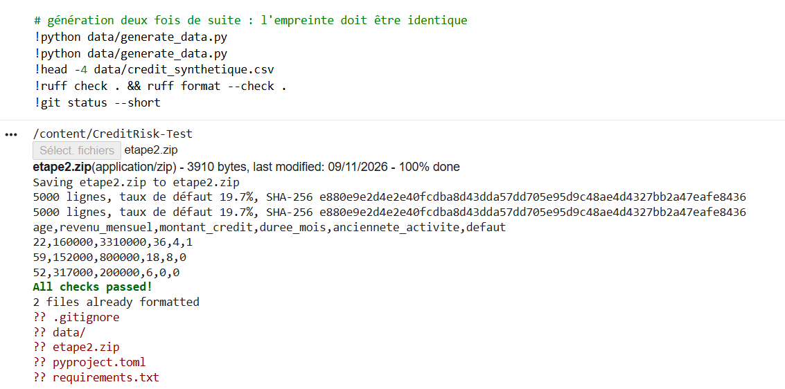

**Exigences.** Le plan de test (`docs/plan_de_test.md`) reprend les 7 exigences de l'énoncé et en ajoute 13 : montant, champs interdits, cohérence âge / ancienneté, absence de trace technique, requêtes mal formées, dimensions, alertes hors domaine, reproductibilité, cohérence métier, métadonnées, critères du modèle, performance, intégration continue.

## 2. Stratégie de test et matrice de traçabilité

**Stratégie.** Six niveaux de test, du composant isolé au système sous charge, s'appuient sur un **modèle de test versionné** : aucun réentraînement n'est nécessaire à chaque modification. Les critères d'acceptation et les tolérances ont été fixés **avant** le développement. Les pannes sont simulées par substitution de composants.

| Niveau | Fichier | Tests | Exécution |
|---|---|---|---|
| Unitaire (validation, prétraitement) | `test_validation.py` | 63 | chaque Pull Request |
| Fonctionnel (API) | `test_api.py` | 37 | chaque Pull Request |
| Intégration | `test_integration.py` | 16 | chaque Pull Request |
| Robustesse | `test_robustness.py` | 99 | chaque Pull Request |
| Non-régression | `test_regression.py` | 20 | chaque Pull Request |
| Performance | `test_performance.py` + `perf/` | 4 | manuelle |
| **Total** | | **239** | **235 rapides réussis ; couverture 87 %** |

**Matrice de traçabilité** (priorité P1 = conséquences graves ; le détail des 32 cas de test, avec préconditions, données d'entrée et risques, figure dans le plan de test, § 4 et § 5) :

| ID | Exigence | Priorité | Preuve | Statut |
|---|---|---|---|---|
| EX01 | Âge dans l'intervalle 18–75 | P1 | `test_validation`, `test_api`, `test_robustness` | Réussi |
| EX02 | Revenu numérique, fini, positif | P1 | idem | Réussi |
| EX03 | Durée entière valide (1–120) | P1 | idem | Réussi |
| EX04 | Probabilité valide dans [0, 1] | P1 | `test_api`, propriété Hypothesis | Réussi |
| EX05 | Indisponibilité du modèle signalée | P1 | `test_api`, `test_integration` | Réussi |
| EX06 | Entrée incomplète rejetée | P1 | `test_api`, `test_robustness` | Réussi |
| EX07 | Non-régression contrôlée | P1 | `test_regression`, `docs/rapport_non_regression.md` | Réussi |
| EX08 | Montant positif et borné | P1 | `test_validation`, `test_api` | Réussi (minimum ajouté en 1.1) |
| EX09 | Champs supplémentaires refusés | P2 | `test_api`, `test_robustness` | Réussi |
| EX10 | Ancienneté cohérente avec l'âge | P2 | `test_validation`, `test_robustness` | Réussi |
| EX11 | Aucune trace technique exposée | P1 | `test_api`, `test_integration` | Réussi |
| EX12 | Requête mal formée rejetée | P2 | `test_api` | Réussi |
| EX13 | Variables et dimensions conformes | P1 | `test_validation`, `test_integration` | Réussi |
| EX14 | Entrée inhabituelle signalée | P2 | `test_robustness` | Réussi (variable dérivée ajoutée en 1.1) |
| EX15 | Prédictions reproductibles | P1 | `test_regression` | Réussi |
| EX16 | Cohérence du risque (montant, revenu, ancienneté) | P2 | `test_robustness` | Réussi |
| EX17 | Métadonnées cohérentes | P2 | `test_api`, `test_integration` | Réussi |
| EX18 | Rappel ≥ 0,70 ; F1 ≥ 0,45 ; AUC ≥ 0,70 (test) | P1 | `reports/evaluation_test_v1.json`, `…_v2.json` | **Échec** (§ 6) |
| EX19 | P95 ≤ 100 ms ; ≥ 50 req/s ; 0 erreur | P3 | `docs/rapport_performance.md` | Réussi (réserve A6) |
| EX20 | CI : Ruff, Pytest, couverture ≥ 80 %, échec bloquant | P2 | workflow, captures § 8 | Réussi |

**19 exigences sur 20 sont satisfaites ; l'exigence non satisfaite (EX18) est l'exigence métier principale.**

## 3. Tests fonctionnels de l'API

Contrat : entrée de 5 champs obligatoires, types stricts, champs supplémentaires interdits ; réponse `probabilite_defaut`, `niveau_risque`, `defaut_predit`, `alertes`, `version_modele` ; erreurs `{erreur, details: [{champ, message}]}` qui ne reprennent jamais les valeurs saisies.

| # | Scénario obligatoire | Code attendu | Réponse et comportement | Résultat |
|---|---|---|---|---|
| 1 | Requête valide | 200 | Probabilité 0,4547, niveau `modere`, aucune alerte, version `v1` | Réussi |
| 2 | Champ obligatoire absent (×5), `null`, objet vide | 422 | Chaque champ manquant nommé (« champ obligatoire manquant ») | Réussi |
| 3 | Âge négatif ; 17 ; 76 | 422 | Champ `age` | Réussi |
| 4 | Revenu en texte (`"250000"`, `"deux cent mille"`) | 422 | Champ `revenu_mensuel` ; la valeur saisie n'est pas renvoyée | Réussi |
| 5 | Montant nul ou négatif | 422 | Champ `montant_credit` | Réussi |
| 6 | Durée non entière (`12.5`, `12.0`, `"12"`) | 422 | Champ `duree_mois` (mode strict : aucune conversion implicite) | Réussi |
| 7 | Champ supplémentaire | 422 | « champ non autorisé » | Réussi |
| 8 | Valeurs extrêmement élevées (10¹², 10¹⁵…) | 422 | Rejet ; une valeur élevée mais autorisée (revenu de 20 millions) donne 200 avec une alerte | Réussi |
| 9 | Modèle indisponible | 503 | `/predict` et `/model-info` : `modele_indisponible` ; `/health` : `degrade` ; une entrée invalide reste en 422 | Réussi |
| 10 | Requête mal formée (JSON tronqué, vide, texte, liste) | 422 | « corps de requête JSON mal formé » ou « un objet JSON est attendu » | Réussi |

**37 tests réussis** (`reports/tests_api.txt`), dont `/health` et `/model-info` (version, variables, seuil, SHA-256).

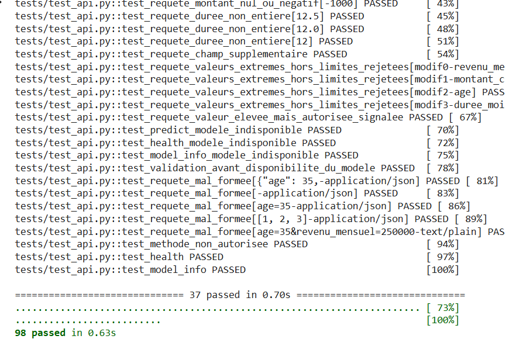

## 4. Tests d'intégration

**Scénario principal** (un seul test de bout en bout) : requête valide → validation → prétraitement (un espion vérifie qu'il est appelé une fois, 6 variables, taux d'endettement 0,333) → prédiction (identique à l'appel direct du modèle) → structure de la réponse → métadonnées (`/model-info` = version, empreinte du modèle et des données réellement chargés).

| Scénario complémentaire | Comportement vérifié |
|---|---|
| Modèle impossible à charger : absent, corrompu, **modifié d'un octet**, contenu invalide, variables différentes | Chargement refusé, message explicite ; API en 503 ; incident journalisé |
| Variable attendue absente | 500 contrôlé |
| Prétraitement en erreur | 500 ; détail absent de la réponse, présent dans les journaux |
| Dimensions incompatibles avec le modèle | 500 ; le modèle n'est **pas** appelé |
| Erreur interne du modèle (message contenant un chemin et un « mot de passe ») | 500 générique, aucune fuite |
| Probabilité invalide (NaN, 1,5, −0,1) | 500, jamais renvoyée au client |
| Requête suivant une panne | 200 : pas d'état corrompu |

**16 tests réussis** (`reports/tests_integration.txt`).

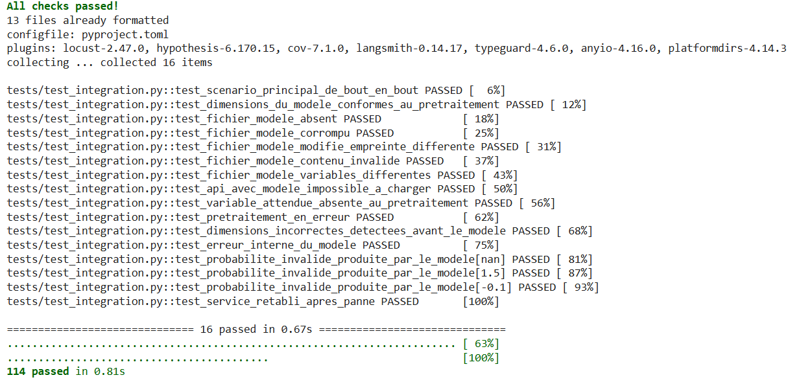

## 5. Résultats des tests de robustesse

| Catégorie | Cas | Résultat |
|---|---|---|
| Valeurs manquantes (`null`) | 5 | Rejetées (422) |
| Non numériques (texte, booléen, liste, objet…) | 30 | Rejetées ; le mode strict refuse aussi `"35"` et `true` |
| Non finies (`NaN`, `Infinity`, `1e400`) | 20 | Rejetées sans trace technique |
| Limites des intervalles (de part et d'autre de chaque borne) | 20 | Bornes respectées |
| Valides mais hors du domaine d'entraînement | 7 | Traitées (200) avec une alerte nommant la variable |
| Schéma incorrect (imbrication, casse, liste…) | 7 | Rejetés |
| Propriétés Hypothesis (150 tirages chacune) | 2 | Toute demande valide donne une probabilité valide ; tout âge hors limites est rejeté |
| Cohérence métier (montant, revenu, ancienneté) | 3 | Variations du risque dans le sens attendu |

L'exploration a révélé **trois anomalies**, d'abord reproduites par des tests marqués `xfail(strict=True)`, puis **corrigées en version 1.1** :

| ID | Anomalie | Gravité | Correction |
|---|---|---|---|
| A1 | Niveau « élevé » dès 0,50 alors que le défaut n'est prédit qu'à 0,52 : une probabilité de 0,510 donnait « élevé » et « défaut non prédit » | Majeure | Niveaux dérivés du seuil du modèle |
| A2 | Mensualité égale à 5 fois le revenu sans aucune alerte : seules les variables saisies étaient contrôlées | Majeure | Alerte sur le taux d'endettement (> 4 écarts-types de la moyenne d'entraînement) |
| A3 | Revenu ou montant de 1 FCFA accepté | Mineure | Minimum de 10 000 FCFA |

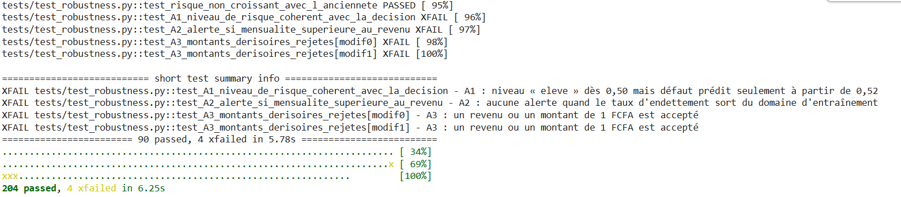

**Version 1.1 : 99 tests de robustesse réussis.** Le registre complet (risque, comportement attendu, résultat observé, gravité, correction) est dans `docs/registre_anomalies.md`.

## 6. Résultats de non-régression

**Référence figée** `reports/reference_v1.json`, créée avant toute modification : empreintes du modèle et des données, version du code, seuil, métriques de validation, lot de contrôle de 200 demandes avec leurs probabilités. Un second appel de création est refusé. Les tolérances ont été fixées dans le plan de test : probabilités ±1e-6 (code), ±1e-9 (rechargement) ; baisse maximale du rappel et du F1 de 0,03, de l'AUC de 0,02. Au-delà : investiguer (jusqu'au double de la tolérance), puis rejeter.

**Comparaison 1 : code 1.1 (corrections A1 à A3).** Écart maximal de probabilité de 0,0 (Colab), 0 décision modifiée sur 200, métriques identiques : **accepter**.

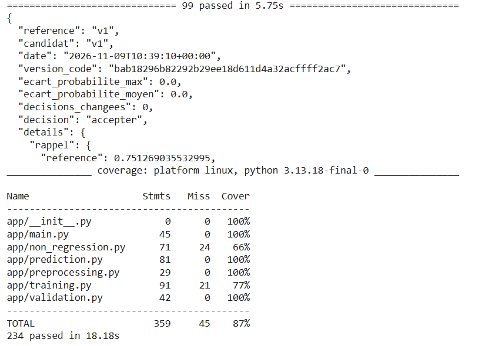

**Comparaison 2 : modèle v2** (même modèle, seuil choisi pour un rappel ≥ 0,80 sur la validation, en réponse à l'anomalie A5).

| Métrique (validation) | v1 | v2 | Écart | Verdict |
|---|---|---|---|---|
| Rappel | 0,751 | 0,807 | + 0,056 | accepter |
| F1 | 0,517 | 0,467 | − 0,050 | **investiguer** |
| ROC-AUC | 0,784 | 0,784 | 0 | accepter |

**Décision : investiguer.** La baisse du F1 est le prix d'un compromis (22 décisions sur 200 changent ; 48 % des demandes signalées au lieu de 38 %), qui relève d'une décision métier.

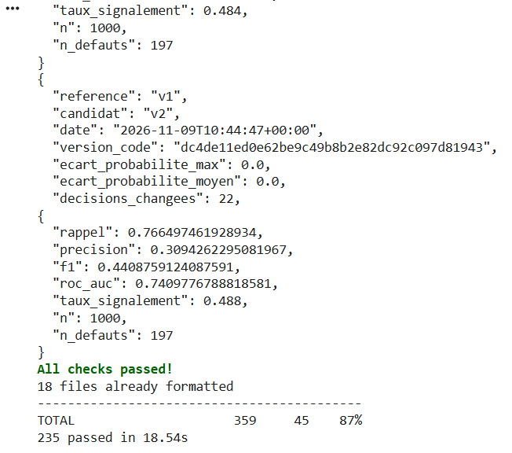

**Évaluation finale sur le jeu de test** (1 000 demandes, 197 défauts) :

| Métrique (test) | v1 | v2 | Critère |
|---|---|---|---|
| Rappel | **0,670** ❌ | 0,766 ✅ | ≥ 0,70 |
| F1 | 0,470 ✅ | **0,441** ❌ | ≥ 0,45 |
| ROC-AUC | 0,741 ✅ | 0,741 ✅ | ≥ 0,70 |

Aucune version ne satisfait les trois critères. Le résultat de v2 est en outre légèrement optimiste, car le jeu de test avait déjà servi à évaluer v1. La capacité de détection elle-même est testée : 8 cas calculés à la main et un modèle volontairement dégradé (seuil à 0,90), qui est bien **rejeté**. Détails : `docs/rapport_non_regression.md`.

## 7. Mesures de performance

Configuration : Google Colab, 2 cœurs, 13,6 Go, Python 3.13.18, Uvicorn avec 1 processus. Objectif justifié par l'usage (un agent attend la réponse ; quelques agents travaillent en même temps) : **P95 ≤ 100 ms, au moins 50 req/s, aucune erreur**.

| Latence | Moyenne | P95 | P99 |
|---|---|---|---|
| Inférence du modèle | 1,95 ms | 2,24 ms | 3,98 ms |
| Pipeline sans HTTP | 6,25 ms | 7,47 ms | 9,73 ms |
| API par HTTP | 9,68 ms | **13,23 ms** | 15,31 ms |

| Clients simultanés | 1 | 5 | 10 | 20 | 50 |
|---|---|---|---|---|---|
| Débit (req/s) | 101 | 112 | **119** | 97 | 91 |
| P95 (ms) | 13 | 69 | 121 | 334 | 1 258 |
| Erreurs | 0 | 0 | 0 | 0 | 0 |

**Locust** (montée jusqu'à 20 agents en 60 s) : 3 072 requêtes, **0 échec**, P95 de 64 ms sur `/predict`.

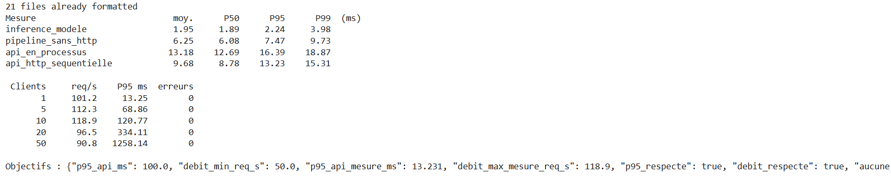

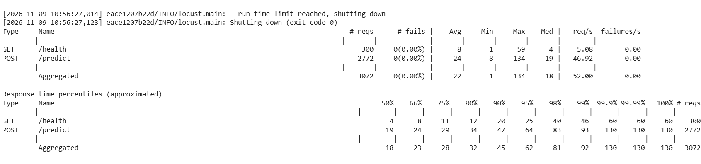

**Interprétation.** Les objectifs sont respectés pour l'usage d'une agence, avec une marge d'un facteur 7 sur la latence. Le serveur sature vers 120 req/s et se dégrade sans erreur ; au-delà d'une dizaine de clients **sans pause**, le P95 dépasse 100 ms (anomalie A6, mineure). Une première version du script de charge créait un client HTTP par requête et sous-estimait le débit d'un facteur 5 : **l'instrument de mesure a lui-même dû être validé**. Détails : `docs/rapport_performance.md`.

## 8. Automatisation avec GitHub Actions

Workflow `.github/workflows/tests.yml`, déclenché à chaque Pull Request et à chaque push sur `main` :
- job `qualite` : Ruff, règles et formatage ;
- job `tests` : Pytest hors tests lents, couverture ≥ 80 % obligatoire, rapports JUnit et couverture conservés en artefacts ;
- job `performance` : lancement manuel.

La branche `main` est protégée par la règle `protection-main` : Pull Request et réussite des deux contrôles obligatoires. L'administrateur du dépôt dispose d'une exemption, conservée volontairement pour publier la documentation.

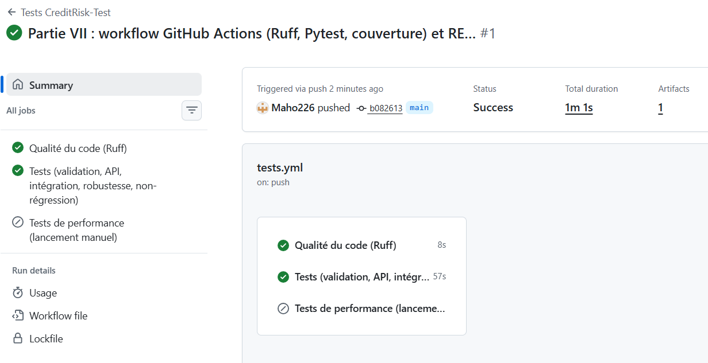

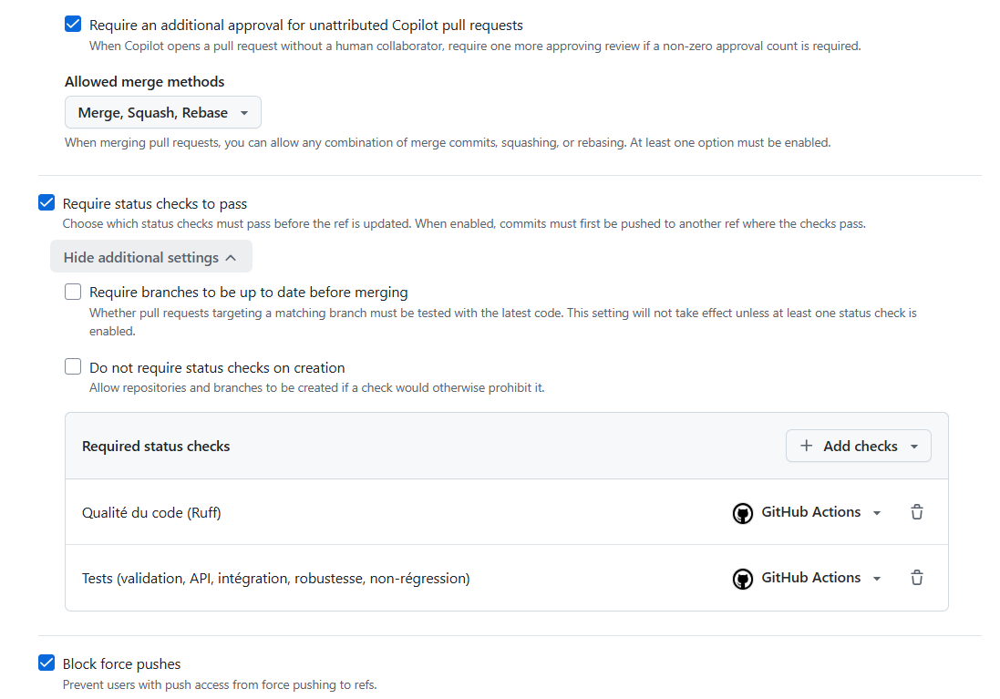

**Démonstration d'un test volontairement défaillant.** Sur la branche `demo/test-defaillant`, le contrôle de cohérence âge / ancienneté a été désactivé. **Les deux contrôles ont détecté le défaut, chacun de son côté** :
- Pytest : 2 tests en échec (limite âge / ancienneté, cohérence EX10) ;
- Ruff : code mort, variable `age` calculée mais inutilisée (F841).

La fusion a été bloquée et la Pull Request #1 fermée sans être fusionnée. Couverture mesurée sur GitHub : 87,15 %.

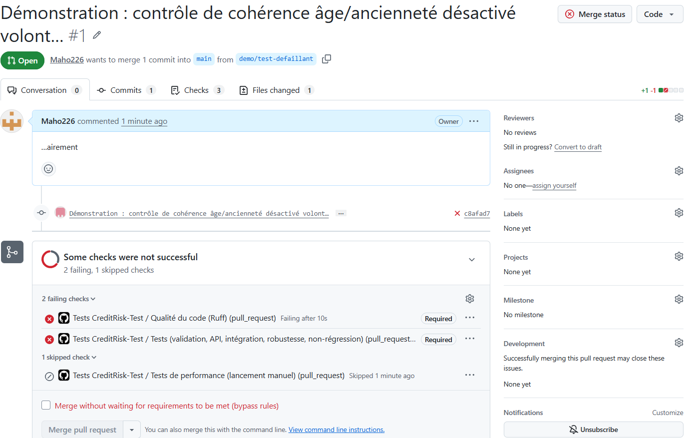

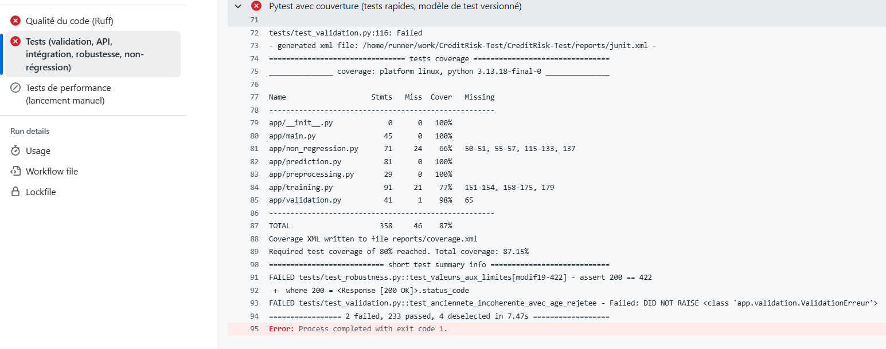

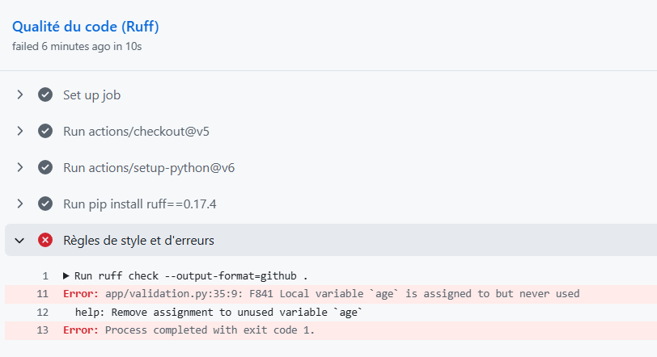

## 9. Anomalies détectées

| ID | Description | Gravité | Statut |
|---|---|---|---|
| A1 | Niveau de risque incohérent avec la décision (entre 0,50 et 0,52) | Majeure | **Corrigée (1.1)** |
| A2 | Taux d'endettement hors domaine non signalé | Majeure | **Corrigée (1.1)** |
| A3 | Revenu ou montant de 1 FCFA accepté | Mineure | **Corrigée (1.1)** |
| A4 | Prédiction extrapolée présentée comme une prédiction ordinaire (seul le champ `alertes` la distingue) | Mineure | Ouverte |
| A5 | Critères du modèle non atteints sur le test : v1 rappel 0,670 ; v2 F1 0,441 | **Bloquante** | Ouverte |
| A6 | Saturation vers 120 req/s ; P95 > 100 ms au-delà de 10 clients sans pause | Mineure | Ouverte |

## 10. Limites de l'évaluation

- **Données synthétiques** : la règle de défaut est connue et simple ; les résultats ne disent rien de la performance sur de vrais demandeurs.
- **Peu de défauts dans le jeu de test** (197) : une dizaine de défauts mal classés suffit à faire varier le rappel de 0,05.
- **Jeu de test réutilisé** pour v1 puis v2 : le résultat de v2 est optimiste.
- **Pas d'attribut sensible** (sexe, région, situation familiale) : aucune analyse d'équité n'est possible.
- **Performance mesurée en local** sur une machine partagée : pas de réseau réel, ni d'endurance.
- **Domaine d'entraînement contrôlé variable par variable** (et pour le taux d'endettement), pas pour l'ensemble des combinaisons possibles.
- Exemption de l'administrateur sur la protection de `main`.

## 11. Recommandations d'amélioration

1. **Revoir les critères du modèle avec le métier**, en chiffrant le coût d'un défaut non détecté et celui d'un bon client refusé ou d'une analyse manuelle. C'est la condition pour arbitrer entre v1 et v2.
2. **Enrichir les données réelles** : historique de remboursement, autres engagements, type d'activité.
3. **Évaluer toute nouvelle version sur des données jamais utilisées**, avec une validation croisée pour réduire la variabilité.
4. **Imposer un examen manuel** quand `alertes` n'est pas vide (A4), et définir avec les agents une règle sur la mensualité rapportée au revenu.
5. **Audit d'équité** sur des données réelles comportant les attributs nécessaires, avant toute décision automatisée.
6. Plusieurs processus Uvicorn si le service est mutualisé entre agences (A6) ; journalisation de chaque décision avec la version du modèle pour l'audit.

## 12. Conclusion : aptitude à une phase pilote

**Validation technique : réussie.** La chaîne logicielle fait ce qu'elle doit faire et le démontre :
- 235 tests automatisés réussis et une couverture de 87 % ;
- un contrat d'entrée strict, des erreurs maîtrisées et sans fuite d'information ;
- une intégration vérifiée de bout en bout, une robustesse documentée, avec trois anomalies corrigées ;
- une non-régression capable de détecter une dégradation ;
- une performance largement suffisante ;
- une intégration continue bloquante.

**Décision : le prototype n'est pas apte à une phase pilote où il influencerait les décisions de crédit.** Le critère métier principal n'est pas atteint (anomalie bloquante A5) : v1 laisse passer un tiers des défauts sur le jeu de test, et v2 ne les détecte mieux qu'au prix d'un F1 insuffisant et d'une demande sur deux signalée. Les données sont de plus synthétiques : aucune conclusion n'est possible sur de vrais demandeurs.

Une suite de tests réussie prouve que le logiciel est **correct et maîtrisé** ; elle ne prouve pas que le modèle est **assez bon, équitable, légalement conforme ou adapté** à une décision de crédit réelle. Le passage en pilote exige d'abord une **décision métier** sur les critères et des **données réelles**. Ensuite seulement, un pilote en **mode observation** pourra être envisagé : le modèle calcule, l'agent décide seul, et l'on compare a posteriori.

## 13. Question de synthèse

> *Supposons que tous les tests fonctionnels et techniques réussissent, mais que le modèle présente encore un taux élevé de faux négatifs pour certains profils de demandeurs. Peut-on recommander sa mise en production ?*

**Non.** La réussite des tests techniques est une condition nécessaire, mais pas suffisante.

**Ce que prouvent les preuves techniques.** Elles établissent que le système **se comporte comme spécifié** : entrées validées, erreurs maîtrisées, intégration correcte, résultats reproductibles, absence de régression, performance suffisante. Dans ce projet, 235 tests, une couverture de 87 % et une CI bloquante le démontrent. Mais ces tests vérifient le **contrat du logiciel**. Ils ne mesurent ni la **qualité des décisions** pour chaque groupe de demandeurs, ni leur **équité**.

**Ce que disent les exigences métier.** Un faux négatif est ici un demandeur qui fera défaut mais que le modèle juge sûr : c'est une **perte financière directe** pour l'institution, et un surendettement pour le client. Un taux de faux négatifs élevé, même limité à **certains profils**, signifie que l'exigence métier principale (le rappel) n'est pas satisfaite pour ces profils. Une moyenne globale acceptable peut masquer un échec concentré sur un groupe. Ce projet montre d'ailleurs que les critères métier peuvent échouer alors que tous les tests techniques réussissent : v1 obtient un rappel de 0,670 sur le test.

**Les risques.**
- **Financier** : pertes concentrées sur les profils mal évalués, et éventuellement exploitables si le défaut est connu.
- **Équité et réputation** : si ces profils correspondent à des groupes (âge, région, type d'activité, genre), le système traite inégalement les demandeurs. C'est un risque de discrimination indirecte et de perte de confiance.
- **Réglementaire** : les décisions de crédit automatisées sont encadrées (protection des données, droit à une explication, exigences des autorités de supervision du secteur financier). Un biais documenté et non corrigé engage la responsabilité de l'institution.
- **Biais d'automatisation** : les agents risquent de faire confiance au score sans le remettre en question.

**Les contrôles complémentaires nécessaires avant une mise en production.**
1. **Mesurer les erreurs par profil** : rappel et taux de faux négatifs par segment (âge, activité, montant, région), avec intervalles de confiance, sur des données **réelles** et un jeu de test jamais utilisé.
2. **Fixer avec le métier, la conformité et la gestion des risques** des critères par profil (écart maximal toléré entre groupes) et le coût relatif des erreurs.
3. **Corriger** : données plus représentatives des profils concernés, variables supplémentaires, seuils ou modèles adaptés, puis **revalider** avec la même suite de non-régression.
4. **Encadrer l'usage** : le modèle aide l'agent mais ne décide pas, avec un examen manuel obligatoire pour les profils à risque d'erreur et les cas hors domaine. Chaque décision est journalisée (version du modèle, probabilité, alertes).
5. **Pilote en mode observation**, puis **surveillance en production** : suivi des faux négatifs par profil à mesure que les remboursements sont connus, alertes de dérive, procédure de retrait du modèle.
6. **Validation indépendante** et documentation pour l'audit et le régulateur.

**Conclusion.** Tant que le taux de faux négatifs reste élevé pour certains profils, la recommandation est **de ne pas mettre en production**. Tout au plus, on peut poursuivre en mode observation pendant la correction. La validation technique dit que le système **fonctionne correctement** ; seules la validation métier, l'analyse des risques et les contrôles d'équité peuvent dire s'il est **acceptable de l'utiliser** pour décider du crédit de personnes réelles.
